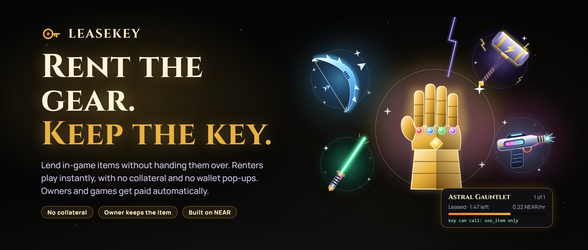
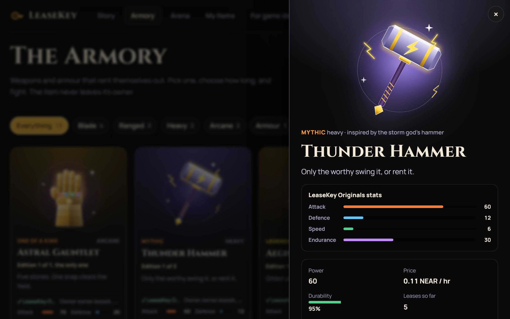
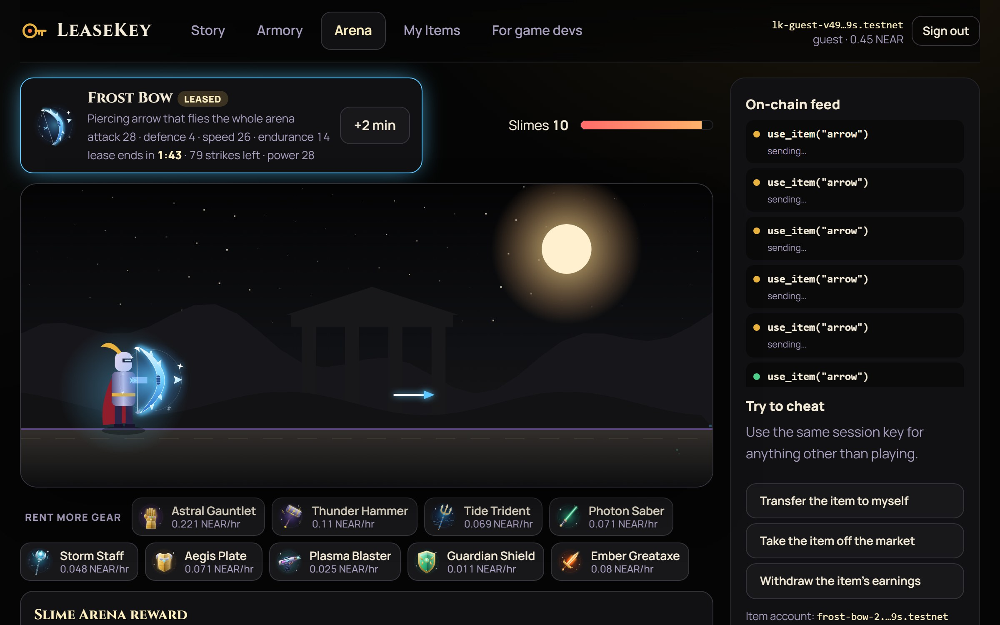
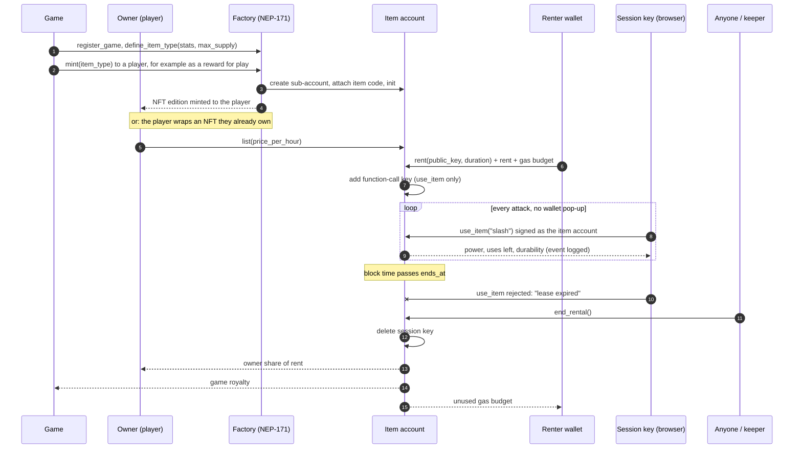
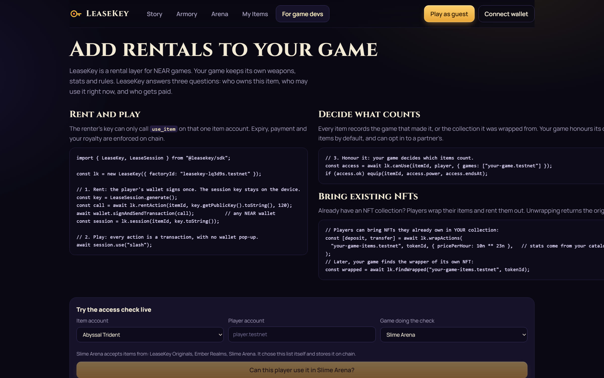

<p align="center">
  
</p>

<p align="center">
  <a href="https://leasekey.vercel.app"><b>Try it live</b></a> ·
  <a href="#see-it"><b>See it</b></a> ·
  <a href="#how-it-works"><b>How it works</b></a> ·
  <a href="#run-it"><b>Run it</b></a> ·
  <a href="#build-on-it"><b>Build on it</b></a> ·
  <a href="https://testnet.nearblocks.io/address/leasekey-lq3d9s.testnet"><b>Live contract</b></a>
</p>

**LeaseKey lets players rent out the rare items they own in a game, without ever handing them over.**

The owner keeps the item. The renter gets a key that can only use it, for exactly as long as they paid. When time runs out, the key stops working and the rent pays the owner and the game. No collateral, no trust, and no wallet pop-ups while playing.

| | |
|---|---|
| **For players** | Use a legendary item for an hour instead of grinding for weeks or buying it outright. |
| **For owners** | Earn from rare items while you're offline. Nobody can keep or sell them. |
| **For games** | Earn a royalty on every rental, with no marketplace to build or run. |

<h2 id="see-it">See it</h2>


**The Armory.** Every item shows the game it belongs to, how rare it is ("Edition 1 of 3"), that game's own stats, and an hourly price that follows its scarcity.

<table>
  <tr>
    <td width="50%"></td>
    <td width="50%"></td>
  </tr>
  <tr>
    <td><b>Every item, in full.</b> Stats from its game, how many will ever exist, who owns it, and its own on-chain account. Pick a length and rent.</td>
    <td><b>Slime Arena, the demo game.</b> It exists to show a lease working inside a real game: the rented bow fires, every shot is a real <code>use_item</code> transaction, the same key cannot steal the item, and when time is up the owner and the game are paid.</td>
  </tr>
</table>

<h2 id="how-it-works">How it works</h2>

**Every item is its own account, and renting hands out a key that can only play.**

1. **The item is an account.** `flame-sword-1.leasekey-lq3d9s.testnet` holds its own rent and state. No person holds a key to it, so only its code controls it.
2. **Renting never moves the item.** The item's account adds a key for the renter that can call one thing, `use_item`. Transfers, sales and withdrawals are rejected by the NEAR protocol itself.
3. **Time is enforced on chain.** When the lease ends the key stops working, anyone can close the lease, and the rent splits between the owner and the game automatically.
4. **Play feels normal.** The key lives on the player's device and the item pays its own gas, so there's no wallet pop-up on any action.
5. **Rare stays rare.** Only games create items, from types they define once with fixed stats. Every copy is its own token and account with its own owner. A game mints copies as they drop, optionally under a hard cap, and a drop can roll its stats but never above its type. Nobody can mint a fake or a stronger version.



### Who can do what

| | Can | Can never |
|---|---|---|
| **Game** | Define its items and their stats once, mint copies to players as they drop (optionally capped, sealable), roll a drop's stats, earn on every lease, choose which games' items it honours | Exceed a cap, reopen a sealed type, roll a copy above its type, change an item type |
| **Owner** | Receive items from games, bring items they already own, set a price, earn rent | Cancel, revoke or take back an item mid-lease |
| **Renter** | Use the item, return early for a refund, extend | Transfer, sell or withdraw it, or keep using it after time is up |

### Why NEAR

- **Named accounts** let an item be an account that owns money and state.
- **Function-call access keys** give a "can use, cannot steal" permission at the protocol level.
- **Global contracts** let every item share one code hash, so each item account costs about 0.15 NEAR to create.

<h2 id="run-it">Run it</h2>

You need only Node.js 22 or newer. The app connects to the live testnet deployment with no setup.

```bash
git clone https://github.com/amannx21/LEASEKEY.git leasekey && cd leasekey
npm install
npm --prefix web install
npm run dev
```

Open http://localhost:5173, click **Play as guest**, rent something in the **Armory**, and fight with it in the **Arena**, a small demo game that shows the lease working from start to finish. Guest mode creates a free testnet account for you, so no wallet is needed.

<details>
<summary><b>Build, test and deploy the contracts</b></summary>

<br>

#### Prerequisites

| Tool | Version tested | Needed for |
|---|---|---|
| Node.js | 22 or 24 | frontend, deploy, keeper, testnet check |
| Rust | 1.98.1 (pinned in `rust-toolchain.toml`, installed automatically by rustup) | building and testing contracts |
| cargo-near | 0.23.0 | building contracts |
| OS | Linux, macOS, or Windows with WSL2 | the contract sandbox tests do not run on native Windows |

The built contracts are committed in `res/`, so the frontend, the deploy script and the testnet check need **only Node.js**.

Install cargo-near (only for building contracts):

```bash
curl --proto '=https' --tlsv1.2 -LsSf https://github.com/near/cargo-near/releases/latest/download/cargo-near-installer.sh | sh
```

#### Check the live contracts from the command line (about 90 seconds)

```bash
npm run e2e
```

This rents an item for 60 seconds with a fresh throwaway account, strikes three times with the session key, proves the key cannot do anything else, waits for expiry, and settles. It prints `PASS` per check and ends with `E2E OK`.

#### Build and test the contracts

```bash
bash scripts/build.sh          # writes res/item.wasm and res/leasekey.wasm
cd tests && cargo test         # 20 sandbox integration tests
cd .. && cargo test            # unit tests for the rent, refund and split math
```

The first `cargo test` in `tests/` downloads the NEAR sandbox binary and takes a few minutes to compile.

#### Deploy your own copy to testnet

```bash
bash scripts/deploy.sh                 # global-contract mode, 12 demo items
MODE=embedded bash scripts/deploy.sh   # fallback: copy the wasm into every item account
```

The script creates throwaway faucet accounts, deploys, seeds demo items, and rewrites `web/src/deployment.json`. Keys are stored in `.leasekey/keys`, which is git-ignored. It never touches mainnet.

#### Run the keeper

```bash
npm run keeper            # loops, ends every expired rental
npm run keeper -- --once  # single pass
```

</details>

<h2 id="build-on-it">Build on it</h2>

A game adds rentals with one check before it honours an item:

```ts
import { LeaseKey } from "@leasekey/sdk";

const lk = new LeaseKey({ factoryId: "leasekey-lq3d9s.testnet" });
const access = await lk.canUse(itemId, player, { games: ["your-game.testnet"] });
if (access.ok) equip(itemId, access.power, access.endsAt);
```



- **The SDK** in [`sdk/`](sdk/) covers renting, session keys, access checks and bringing in existing NFTs. `npm run sdk:example` runs a full rent, play and return against testnet.
- **A complete example game.** [`contracts/arena-game`](contracts/arena-game/src/lib.rs) is a game built only on LeaseKey's public interface. It decides which games' items it accepts and rewards its own players by minting rare items.
- **Bring an existing collection.** Players can deposit NFTs they already own from an integrated game. LeaseKey holds the original, applies the game's own stats, and returns it on request.

## Live on testnet

**Try it: [leasekey.vercel.app](https://leasekey.vercel.app)**. Click "Play as guest" for a free throwaway testnet account, rent anything in the Armory and take it into the Arena, the demo game where you watch the lease work on chain. No wallet needed.

| | Account |
|---|---|
| LeaseKey contract | [`leasekey-lq3d9s.testnet`](https://testnet.nearblocks.io/address/leasekey-lq3d9s.testnet) |
| An item, as its own account | [`flame-sword-1.leasekey-lq3d9s.testnet`](https://testnet.nearblocks.io/address/flame-sword-1.leasekey-lq3d9s.testnet) |
| Slime Arena, an example game | [`arena.leasekey-lq3d9s.testnet`](https://testnet.nearblocks.io/address/arena.leasekey-lq3d9s.testnet) |
| Ember Realms, an example game collection | [`ember.leasekey-lq3d9s.testnet`](https://testnet.nearblocks.io/address/ember.leasekey-lq3d9s.testnet) |

## How it compares

| Approach | How the renter gets access | What it leaves open |
|---|---|---|
| Transfer and trust (Axie-style scholarships) | The item or account is handed over | The renter can keep or misuse it |
| Collateralized rental (for example reNFT's default mode) | The renter posts collateral worth the item | Shuts out players who cannot afford the item |
| A "user" role on the token (ERC-4907) or a rental registry (reNFT collateral-free) | A temporary role the game reads | In the ERC-4907 reference flow the lender can reset the user and end the rental early |
| A game's own rental market (Splinterlands) | Built into that one game | Works only inside that game |
| **LeaseKey** | A NEAR access key on the item's own account that can only call `use_item` | See below |

LeaseKey's difference: the renter acts through a real key with no wallet and no gas, the owner can never end a lease early, the item escrows and pays out its own rent, and scarcity and game identity are built into the protocol. Like every approach above, a game still has to check the lease for it to matter.

## Questions you might ask

<details>
<summary><b>Thirteen questions, short answers</b></summary>

<br>

**What does the NFT actually do here?** It is the ownership record. The item itself is a NEAR account that holds the rent, runs the lease and pays out. Whoever owns the NFT owns the account's earnings.

**Can anyone mint a fake "legendary sword"?** No. Only registered games mint, only from item types they defined. Every item records the game that made it, and a game honours only the games it chooses. A copycat's sword is labelled with the copycat's game forever.

**A game has thousands of the same common sword. Does it have to say how many?** No. A type can have no fixed count: the game mints a copy each time one drops, and every copy shows how many exist so far. A cap is optional, and a game can seal the count later. Common loot usually stays in the game's own inventory; it is minted when its player wants to rent it out.

**Are all copies of a drop identical?** Only if the game wants that. A drop can roll its own stats, never above its type's.

**Several people own the same rare item. How do renters choose?** Each copy has its own owner, price and lease. The item page lists the other copies, available and cheapest first.

**What stops the renter from keeping the item?** The renter never holds it. They get a key that can only call `use_item` on that one account, and the item refuses it after expiry.

**What stops the owner from pulling the item mid-lease?** The item contract has no way to unlist, reprice, revoke or unwrap during a lease. Paid time is the renter's.

**What if LeaseKey disappears?** Every item keeps working. Its contract is locked by its hash, so once an item is made nobody can change its rules, including us, and anyone can close an expired lease to trigger the payouts. The one upgradable piece is the factory that creates new items; moving its upgrades to a DAO is on the roadmap.

**Who pays the owner when time is up?** Anyone can close a finished lease. The arena does it for its players, a keeper script does it on a schedule, and the next renter's rent closes it automatically.

**I lost my browser data mid-lease.** The renter's own account replaces the lost play key with one click ("Get a new play key here"); the old key stops working at once. "Play on another device" moves a lease with a link instead.

**Does an item work in more than one game?** Each game decides. Slime Arena honours LeaseKey Originals and Ember Realms items; any game honours its own. The game reads the item's stats and the lease in one call.

**What does it cost?** About 0.16 NEAR of storage per item, paid once by whoever creates it and returned when the owner retires the item. Renters pay rent plus a refundable 0.1 NEAR gas budget, which covers 200 on-chain strikes. No collateral.

**How does LeaseKey make money?** Two fees, both enforced on chain: 2% of every rent at settlement, paid by the item itself, and 0.01 NEAR per item created or wrapped. Owners keep the rest after the game's royalty, games earn that royalty on every lease, and renters pay nothing on top. The developer page has a calculator, and the contract reports its creation-fee earnings through `get_earnings`.

</details>

## Under the hood

<details>
<summary><b>Everything that is built, and the test or screen that proves it</b></summary>

<br>

Tests live in [`tests/tests/p0.rs`](tests/tests/p0.rs) and [`tests/tests/games.rs`](tests/tests/games.rs). "Demo" refers to [DEMO.md](DEMO.md).

| Feature | How to verify |
|---|---|
| Mint creates the NFT and the item's own account | test `mint_creates_item_account_and_nft`, demo step 1 |
| List and unlist | test `rent_validates_payment_listing_and_duration`, My Items page |
| Any lease length, up to the owner's limit | test `rent_validates_payment_listing_and_duration`; Armory "Custom" length, "up to … h" on My Items |
| Rent adds a key restricted to `use_item` on the item account | test `rent_adds_restricted_session_key_and_use_item_works` |
| `use_item` works only with the renter's key | test `use_item_rejects_strangers_and_wrong_keys` |
| Renter cannot transfer, sell or withdraw | test `renter_cannot_transfer_sell_or_withdraw`, demo step 5, `npm run e2e` |
| Key is rejected after expiry | test `key_rejected_after_expiry`, demo step 6 |
| `end_rental` by anyone deletes the key and settles | test `end_rental_deletes_key_splits_revenue_and_never_settles_twice` |
| No double settlement | same test, `npm run e2e` |
| Revenue split, owner plus creator royalty | same test, unit test `split_math` |
| Owner cannot rug during a rental | test `owner_cannot_rug_during_rental` |
| A transfer of the NFT carries the lease over intact | test `owner_cannot_rug_during_rental` |
| Early return with pro-rata refund, 5% fee | test `early_return_refunds_unused_time_pro_rata`, unit test `pro_rata_refund_math` |
| Item ledger view `get_item` | every test reads it; Marketplace page |
| Global-contract mode | test `global_contract_mode_mints_and_rents` |
| Durability and repair (P1) | test `durability_wears_down_and_owner_repairs` |
| Extend a running lease (P1) | test `extend_adds_time_and_rent`, "+2 min" in the game |
| Gameplay with no wallet pop-ups | demo step 4: the on-chain feed shows one transaction per strike |
| 12 items with eight distinct attack styles | Armory page, then fight in the Arena |
| Only registered games can mint; items record their game | test `only_registered_games_mint_and_items_record_their_game`; My Items, Game studio |
| Item types fixed forever; copies numbered "2 of 5" under a cap, or "Copy #7 · 12 exist so far" for open drops that a game can seal | tests `supply_caps_fixed_power_and_verified_games`, `open_supply_for_random_drops_then_seal_it`; Armory cards |
| Random drops roll their own stats, never above the type's | test `drops_roll_their_own_stats_but_never_above_the_type`; Studio in My Items |
| Renting an item whose last lease expired closes that lease first, in the same click | Armory: an expired item shows "Rent it" |
| Move a lease to another device | Arena: "Play on another device" copies a link that carries only that lease's play key |
| Replace a lost play key from the renter's own account | test `renter_resets_a_lost_key_then_owner_retires_the_item`; My Items: "Get a new play key here" |
| Retire an item and get its storage deposit back | same test; My Items: "Retire"; live run `npx tsx scripts/lifecycle.ts` |
| LeaseKey earns 0.01 NEAR per item created and reports it with `get_earnings` | test `open_supply_for_random_drops_then_seal_it`; developer page "Who earns what" |
| LeaseKey's 2% fee on settled rent | test `end_rental_deletes_key_splits_revenue_and_never_settles_twice`, unit test `split_math` |
| Game-defined stats (attack, defence, speed, endurance…), fixed once set, used by the Arena | same test; Armory cards and item panel; Arena |
| Verified partner games, shown by default in the Armory | same test; "Verified games" filter |
| The demo Arena only honours its own and its partner's items | Arena: items from other games are refused with a reason |
| Rent guided by scarcity | My Items: "Suggest" price from supply and power |
| A game is a separate contract using only LeaseKey's public interface: Slime Arena chooses which games' items it honours and rewards its players by calling the ordinary `mint`. LeaseKey itself never hands out items | test `a_separate_game_contract_rewards_its_players_through_public_mint`; Arena "Slime Arena reward"; `npx tsx scripts/drop-check.ts` |
| Wrapped items take their name, art, power and stats from their game's catalogue. Owners set only the price, collections that are not integrated games are refused, and unwrapping is blocked during a lease | test `wrap_any_nft_rent_it_then_unwrap_it`; My Items, "Bring an item from another game" |
| Factory upgraded in place without losing items | test `migrate_from_v1_keeps_items_and_credits_them_to_the_house_game` |
| Owner and game shown on every item; "Mine" filter | Armory page |
| Game integration SDK | `npm run sdk:example`; "For game devs" page |
| Live economy charts read from chain | landing page, "The economy, live from testnet" |

</details>

<details>
<summary><b>Architecture</b></summary>

<br>

| Path | What it is |
|---|---|
| `contracts/item` | Item contract on every item account: rental state, `use_item`, `end_rental`, early return, extend, durability, earnings and split |
| `contracts/leasekey` | Factory and NEP-171 NFT contract: game registry, game-only minting, wrapping and unwrapping of external NFTs, transfer, enumeration, listing index |
| `contracts/demo-nft` | A plain NEP-171 collection standing in for another game's items |
| `contracts/arena-game` | Slime Arena, the demo game: its own contract and registered game, integrating through LeaseKey's public interface only |
| `sdk/` | TypeScript SDK for games: rent, session keys, `canUse`, wrapping |
| `docs/DESIGN-QA.md` | Hard design questions, with answers and the fixes they led to |
| `tests/` | near-workspaces sandbox tests for every P0 rule |
| `web/` | Vite, React, TypeScript: landing page, Armory, Arena, My Items |
| `scripts/` | `build.sh`, `deploy.sh`, `deploy.ts`, `upgrade.ts`, `keeper.ts`, `e2e.ts` |
| `res/` | Built wasm files |
| `assets/` | Original CC0 item art |

**Mode shipped: per-item sub-accounts with a global contract.** The fallback single-contract mode was not needed. The factory also supports an embedded mode that copies the wasm into each item account, and the sandbox tests run in both modes.

**Money flow.** `rent` takes the rent plus a gas budget of at least 0.01 NEAR. Each `use_item` is charged a flat 0.0005 NEAR against that budget, which covers the measured gas cost of about 0.0002 NEAR that the item account pays. At settlement the unused budget returns to the renter. Every payout uses a callback, and a failed transfer is credited to a `claim()` balance, so funds cannot get stuck.

</details>

<details>
<summary><b>Security model and known limitations</b></summary>

<br>

| | Can | Cannot, and what stops it |
|---|---|---|
| **Renter's key** | Call `use_item` on its one item, until expiry or until its gas budget runs out | Call any other method or contract, move NEAR, or exceed its gas allowance. The NEAR protocol rejects these. |
| **Owner during a lease** | Transfer the item; the lease continues and rent goes to whoever owns it at the end | Unlist, reprice, end the lease, revoke the key, unwrap or retire. The item contract has no path for it. |
| **Renter's own account** | Return early, extend, or replace a lost play key (`reset_key`) during the lease | Reset the key after expiry or for someone else's lease. |
| **Owner, no lease running** | Retire the item: its account is deleted and its storage deposit returns to the owner | Retire while leased or while payouts are unclaimed. |
| **Game** | Define types, mint copies (up to the cap if it set one), seal an open type, roll a drop's stats | Exceed a cap, reopen a sealed type, roll above the type, or change a type. The contract refuses. |

- The factory account still has a full-access key held by the deployer, and was used once to upgrade the factory in place. A malicious deployer could upgrade it again and reassign item owners or release escrowed NFTs. Production would remove that key or hand it to a DAO. Item code itself is immutable because it is referenced by hash.
- After expiry the key stays on the account until someone calls `end_rental`. The contract rejects it in the meantime. The keeper and the game client both call `end_rental`.
- The session key is stored in the browser's `localStorage`. It can only play, so a leak costs at most the remaining gas budget. "Play on another device" moves it with a link that keeps the key in the URL fragment, which is never sent to a server. If it is lost, the renter's own account can still return the item early for a refund of the unused time.
- The shortest rental is 60 seconds, the longest is set per item, 2 hours for the demo items.
- Guest mode uses the public testnet faucet, which is rate limited per address. As a fallback, `web/src/deployment.json` contains the key of a small testnet-only guest bank account that creates guest accounts. That key is public on purpose, holds only a few testnet NEAR, and anyone could drain it. `npm run bank -- 5` refills it from the factory.
- Public testnet RPC endpoints are rate limited. Set `VITE_RPC_URL` or `NEAR_RPC_URL` to use your own.
- The wallet path uses NEAR Wallet Selector with MyNearWallet and Meteor. The automated checks and our manual run-through exercised the guest path; the wallet path is implemented but less tested.
- Wrapping costs the same as a mint and is prepaid with `deposit_for_wrap`, because an NFT transfer carries no NEAR. Unused credit can be withdrawn.
- A wrapped NFT is matched to its game's catalogue by its title, so a game must define an item type for each kind of NFT it wants rentable.
- Slime Arena's reward rolls prove paid play, not skill: the contract counts on-chain strikes, which a script could send. Rewards are bounded by the supply caps and paid from the game contract's own balance.
- The session key's gas allowance covers roughly eight strikes in flight at once. Faster bursts fail until earlier ones confirm.
- Not audited. Testnet only.

</details>

## Roadmap

- Publish the SDK to npm.
- Several royalty receivers per item, for items honoured by more than one game.
- A second playable game, to show cross-game rules from both sides.
- Renter reputation with a minimum-reputation setting per listing.
- Gasless renting through meta transactions (NEP-366) and a relayer, so the renter needs no NEAR at all.
- Guild pools owned by a Sputnik DAO, with a rent share to the treasury.
- Rent paid in any token through NEAR Intents.
- Remove the factory's full-access key and move upgrades to a DAO.
- Shrink the item wasm, currently 182 KB.

## License

MIT. All item art is original and released under CC0. Fonts are Cinzel and Manrope, under the SIL Open Font License.
