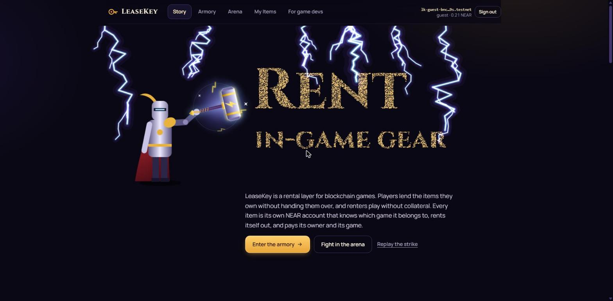
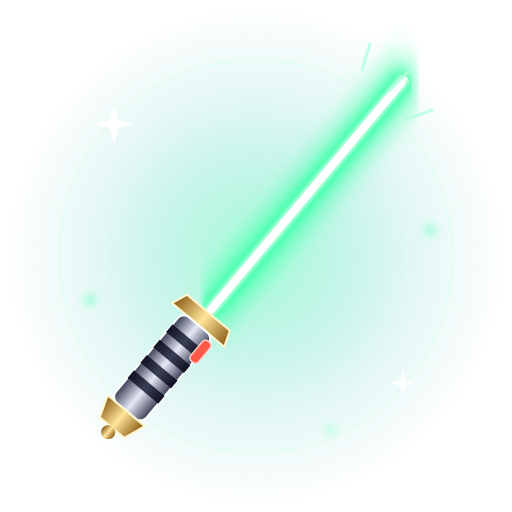
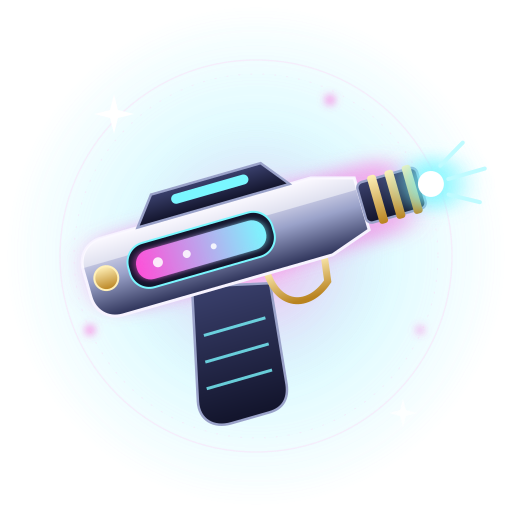
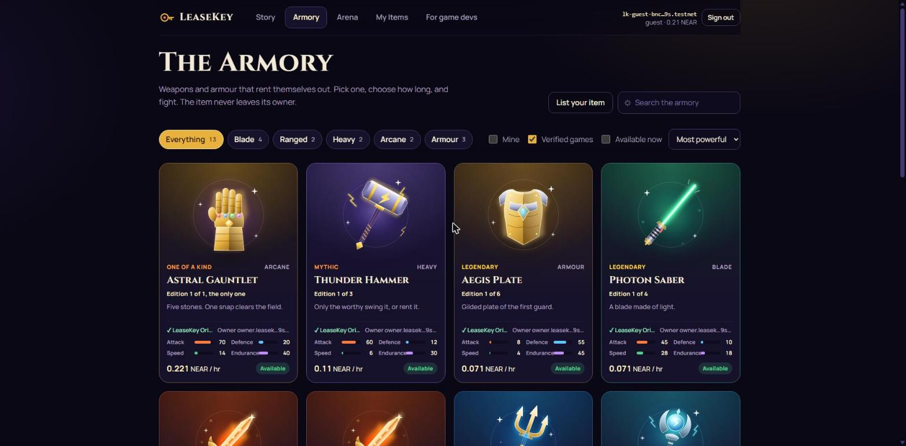
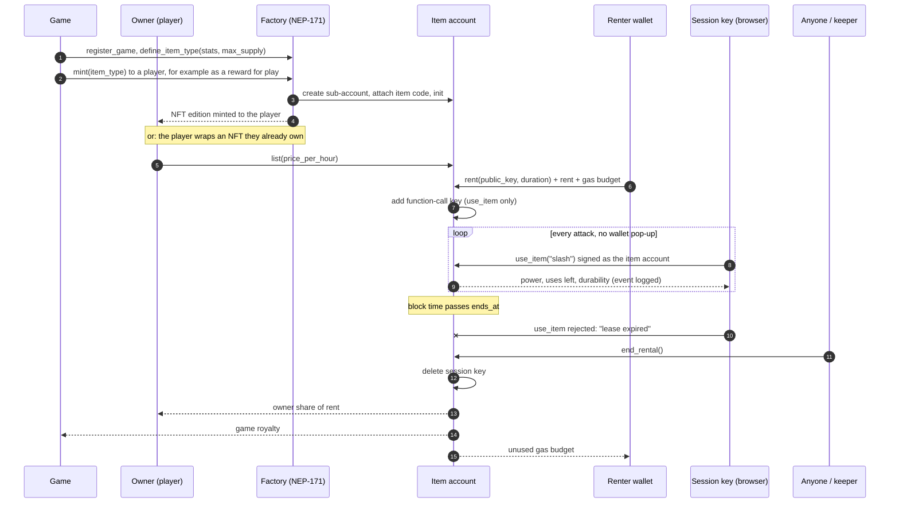

<h1 align="center">LeaseKey</h1>

<p align="center">
  <b>Rent in-game gear on NEAR. No collateral. No trust. No wallet pop-ups.</b><br>
  A rental layer for blockchain games, where every item is its own account that rents itself out.
</p>

<p align="center">
  
  
  
  
</p>

<p align="center">
  
</p>

<p align="center">
  
  
  
  
  
  
  
  
</p>

## The problem

In blockchain games, players truly own their items. That is exactly what makes lending them risky.

| Today's way to rent | What goes wrong |
|---|---|
| **Hand the item over** and trust the renter | Owners lose items and earnings. This is how game "scholarships" failed. |
| **Demand collateral** worth the whole item | Shuts out exactly the players who cannot afford the item. |

Rare items sit idle in their owners' wallets, and players who cannot afford them cannot play with them.

## The idea

**The item is an account, and renting hands out a key that can only play.**

1. **Every item is its own NEAR account.** `flame-sword-1.leasekey-lq3d9s.testnet` holds its own rent and state, and no person holds a key to it. Only its code controls it.
2. **Renting never moves the item.** The item's account adds an access key for the renter that can call one method, `use_item`, and nothing else. Transfers, sales and withdrawals are rejected by the NEAR protocol itself.
3. **The clock is enforced on chain.** After expiry the key stops working, anyone can close the lease, and the rent splits between the owner and the game.
4. **Players never notice the chain.** The key lives in the browser and the item pays its own gas, so every strike is a real transaction with no wallet pop-up.
5. **Scarcity is protected.** Only registered games create items, from types they defined once with fixed stats and a hard supply cap. Nobody can mint a copy or a stronger version.

<table>
  <tr>
    <td width="50%"></td>
    <td width="50%"></td>
  </tr>
  <tr>
    <td><b>The Armory.</b> Every item shows its game, its edition ("1 of 5"), the game's own stats, and a price that follows scarcity.</td>
    <td><b>The Arena.</b> Each strike with a rented item is a signed transaction. The feed on the right shows them landing, and the "Try to cheat" buttons show the key refusing everything else.</td>
  </tr>
</table>

## Try it in two minutes

You need only Node.js 22 or newer. The app talks to the live testnet deployment with no configuration.

```bash
git clone https://github.com/amannx21/LEASEKEY.git leasekey && cd leasekey
npm install
npm --prefix web install
npm run dev
```

Open http://localhost:5173, click **Play as guest**, rent something in the **Armory**, and fight in the **Arena**. No wallet is needed: guest mode creates a throwaway testnet account.

To check the live contracts from the command line instead, run `npm run e2e`. It rents an item, plays, tries to steal it, waits for expiry and settles, printing `PASS` per check.

## How a lease works



### Why this only works on NEAR

- **Named sub-accounts** let an asset be an account that owns money and state.
- **Function-call access keys** give a scoped permission at the protocol level, so "can play but cannot steal" does not depend on anyone's good behaviour.
- **Global contracts** let every item account share one immutable code hash, so an item account costs about 0.15 NEAR instead of 1.8 NEAR.

## Who does what

| Role | What they do | What they can never do |
|---|---|---|
| **Game** | Registers, defines item types with stats and supply caps, mints editions to players, earns a royalty on every lease, decides which games' items it honours | Mint past a cap, mint a stronger copy, or change a type once defined |
| **Owner** | Receives items from games or wraps one they already own, sets a price, earns rent | Cancel, unlist, revoke or unwrap during a lease |
| **Renter** | Pays rent, plays with a session key, returns early for a refund, extends | Transfer, sell or withdraw anything, or play after expiry |
| **LeaseKey** | Runs the rental layer | Hand out items. That is always a game's job |

## Live on NEAR testnet

| What | Where |
|---|---|
| Factory and NEP-171 contract | [`leasekey-lq3d9s.testnet`](https://testnet.nearblocks.io/address/leasekey-lq3d9s.testnet) |
| Example item account | [`flame-sword-1.leasekey-lq3d9s.testnet`](https://testnet.nearblocks.io/address/flame-sword-1.leasekey-lq3d9s.testnet) |
| Slime Arena, the demo game: its own contract and registered game | [`arena.leasekey-lq3d9s.testnet`](https://testnet.nearblocks.io/address/arena.leasekey-lq3d9s.testnet) |
| Ember Realms, a second game's item collection, for wrapping | [`ember.leasekey-lq3d9s.testnet`](https://testnet.nearblocks.io/address/ember.leasekey-lq3d9s.testnet) |
| Launch collection "LeaseKey Originals" | the factory account |
| Demo item owner | `owner.leasekey-lq3d9s.testnet` |
| Item code | Global contract, referenced by code hash |
| Frontend | Run locally with `npm run dev`. Not hosted yet. It is a static Vite build, so `npm run build:web` and any static host will serve `web/dist`. |

The IDs are also in [`web/src/deployment.json`](web/src/deployment.json) and [`.env.example`](.env.example).

## Run everything

### Prerequisites

| Tool | Version tested | Needed for |
|---|---|---|
| Node.js | 22 or 24 | frontend, deploy, keeper, testnet check |
| Rust | 1.98.1 (pinned in `rust-toolchain.toml`, installed automatically by rustup) | building and testing contracts |
| cargo-near | 0.23.0 | building contracts |
| OS | Linux, macOS, or Windows with WSL2 | the contract sandbox tests do not run on native Windows |

The built contracts are committed in `res/`, so the frontend, the deploy script and the testnet check need **only Node.js**.

Install cargo-near (only for building contracts):

```bash
curl --proto '=https' --tlsv1.2 -LsSf https://github.com/near/cargo-near/releases/latest/download/cargo-near-installer.sh | sh
```

### 1. Install

```bash
git clone https://github.com/amannx21/LEASEKEY.git leasekey && cd leasekey
npm install
npm --prefix web install
```

### 2. Run the frontend against the live testnet deployment

```bash
npm run dev
```

Open http://localhost:5173. The landing page explains the idea. Click **Play as guest**, open the **Armory**, rent any of the 12 weapons and armour pieces for 2 minutes, and fight in the **Arena**. Each item has its own attack style. On **My Items** you can also claim an item from the demo game "Ember Realms" and wrap it to rent it out. No wallet is needed: guest mode creates a throwaway testnet account from the public faucet. If the faucet is rate limited, the deployment's guest bank account funds it instead.

### 3. Verify the live deployment from the command line (about 90 seconds)

```bash
npm run e2e
```

This rents an item for 60 seconds with a fresh throwaway account, strikes three times with the session key, proves the key cannot do anything else, waits for expiry, and settles. It prints `PASS` per check and ends with `E2E OK`.

### 4. Build and test the contracts

```bash
bash scripts/build.sh          # writes res/item.wasm and res/leasekey.wasm
cd tests && cargo test         # 17 sandbox integration tests
cd .. && cargo test            # unit tests for the rent, refund and split math
```

The first `cargo test` in `tests/` downloads the NEAR sandbox binary and takes a few minutes to compile.

### 5. Deploy your own copy to testnet (optional)

```bash
bash scripts/deploy.sh                 # global-contract mode, 12 demo items
MODE=embedded bash scripts/deploy.sh   # fallback: copy the wasm into every item account
```

The script creates throwaway faucet accounts, deploys, seeds demo items, and rewrites `web/src/deployment.json`. Keys are stored in `.leasekey/keys`, which is git-ignored. It never touches mainnet.

### 6. Run the keeper (optional)

```bash
npm run keeper            # loops, ends every expired rental
npm run keeper -- --once  # single pass
```

## What is built, and how to verify each part

Sandbox tests live in [`tests/tests/p0.rs`](tests/tests/p0.rs) and [`tests/tests/games.rs`](tests/tests/games.rs). "Demo" refers to the steps in [DEMO.md](DEMO.md).

<details>
<summary><b>Full feature list with the test or screen that proves each one</b></summary>

<br>

| Feature | How to verify |
|---|---|
| Mint creates the NFT and the item's own account | test `mint_creates_item_account_and_nft`, demo step 1 |
| List and unlist | test `rent_validates_payment_listing_and_duration`, My Items page |
| Rent adds a key restricted to `use_item` on the item account | test `rent_adds_restricted_session_key_and_use_item_works` |
| `use_item` works only with the renter's key | test `use_item_rejects_strangers_and_wrong_keys` |
| Renter cannot transfer, sell or withdraw | test `renter_cannot_transfer_sell_or_withdraw`, demo step 5, `npm run e2e` |
| Key is rejected after expiry | test `key_rejected_after_expiry`, demo step 6 |
| `end_rental` by anyone deletes the key and settles | test `end_rental_deletes_key_splits_revenue_and_never_settles_twice` |
| No double settlement | same test, `npm run e2e` |
| Revenue split, owner plus creator royalty | same test, unit test `split_math` |
| Owner cannot rug during a rental | test `owner_cannot_rug_during_rental` |
| A transfer of the NFT carries the lease over intact | test `owner_cannot_rug_during_rental` |
| Early return with pro-rata refund, 5% fee | test `early_return_refunds_unused_time_pro_rata`, unit test `pro_rata_refund_math` |
| Item ledger view `get_item` | every test reads it; Marketplace page |
| Global-contract mode | test `global_contract_mode_mints_and_rents` |
| Durability and repair (P1) | test `durability_wears_down_and_owner_repairs` |
| Extend a running lease (P1) | test `extend_adds_time_and_rent`, "+2 min" in the game |
| Gameplay with no wallet pop-ups | demo step 4: the on-chain feed shows one transaction per strike |
| 12 items with eight distinct attack styles | Armory page, then fight in the Arena |
| Only registered games can mint; items record their game | test `only_registered_games_mint_and_items_record_their_game`; My Items, Game studio |
| Hard supply caps per item type, power fixed by the type, editions like "2 of 5", types can never change | test `supply_caps_fixed_power_and_verified_games`; Armory cards |
| Game-defined stats (attack, defence, speed, endurance…), fixed once set, used by the Arena | same test; Armory cards and item panel; Arena |
| Verified partner games, shown by default in the Armory | same test; "Verified games" filter |
| The demo Arena only honours its own and its partner's items | Arena: items from other games are refused with a reason |
| Rent guided by scarcity | My Items: "Suggest" price from supply and power |
| A game is a separate contract using only LeaseKey's public interface: Slime Arena chooses which games' items it honours and rewards its players by calling the ordinary `mint`. LeaseKey itself never hands out items | test `a_separate_game_contract_rewards_its_players_through_public_mint`; Arena "Slime Arena reward"; `npx tsx scripts/drop-check.ts` |
| Wrapped items take their name, art, power and stats from their game's catalogue. Owners set only the price, collections that are not integrated games are refused, and unwrapping is blocked during a lease | test `wrap_any_nft_rent_it_then_unwrap_it`; My Items, "Bring an item from another game" |
| Factory upgraded in place without losing items | test `migrate_from_v1_keeps_items_and_credits_them_to_the_house_game` |
| Owner and game shown on every item; "Mine" filter | Armory page |
| Game integration SDK | `npm run sdk:example`; "For game devs" page |
| Live economy charts read from chain | landing page, "The economy, live from testnet" |

</details>

## Architecture

| Path | What it is |
|---|---|
| `contracts/item` | Item contract on every item account: rental state, `use_item`, `end_rental`, early return, extend, durability, earnings and split |
| `contracts/leasekey` | Factory and NEP-171 NFT contract: game registry, game-only minting, wrapping and unwrapping of external NFTs, transfer, enumeration, listing index |
| `contracts/demo-nft` | A plain NEP-171 collection standing in for another game's items |
| `contracts/arena-game` | Slime Arena, the demo game: its own contract and registered game, integrating through LeaseKey's public interface only |
| `sdk/` | TypeScript SDK for games: rent, session keys, `canUse`, wrapping |
| `docs/DESIGN-QA.md` | Hard design questions, with answers and the fixes they led to |
| `tests/` | near-workspaces sandbox tests for every P0 rule |
| `web/` | Vite, React, TypeScript: landing page, Armory, Arena, My Items |
| `scripts/` | `build.sh`, `deploy.sh`, `deploy.ts`, `upgrade.ts`, `keeper.ts`, `e2e.ts` |
| `res/` | Built wasm files |
| `assets/` | Original CC0 item art |

**Mode shipped: per-item sub-accounts with a global contract.** The fallback single-contract mode was not needed. The factory also supports an embedded mode that copies the wasm into each item account, and the sandbox tests run in both modes.

**Money flow.** `rent` takes the rent plus a gas budget of at least 0.01 NEAR. Each `use_item` is charged a flat 0.0005 NEAR against that budget, which covers the measured gas cost of about 0.0002 NEAR that the item account pays. At settlement the unused budget returns to the renter. Every payout uses a callback, and a failed transfer is credited to a `claim()` balance, so funds cannot get stuck.

## Security

| | Can | Cannot, and what stops it |
|---|---|---|
| **Renter's session key** | Call `use_item` on the one item it was added to, until expiry or until its gas budget runs out | Call any other method or contract, attach or move NEAR, or exceed its gas allowance. The NEAR protocol rejects these. |
| **Owner during a lease** | Transfer the item; the lease continues and rent goes to whoever owns it at settlement | Unlist, reprice, end the lease early, revoke the key or unwrap. The item contract has no path for it, and there is no burn method. |
| **Game** | Define types and mint editions up to the cap | Exceed a cap or alter a type. The factory refuses. |

<details>
<summary><b>Known limitations</b></summary>

<br>

- The factory account still has a full-access key held by the deployer, and was used once to upgrade the factory in place. A malicious deployer could upgrade it again and reassign item owners or release escrowed NFTs. Production would remove that key or hand it to a DAO. Item code itself is immutable because it is referenced by hash.
- After expiry the key stays on the account until someone calls `end_rental`. The contract rejects it in the meantime. The keeper and the game client both call `end_rental`.
- The session key is stored in the browser's `localStorage`. It can only play, so a leak costs at most the remaining gas budget.
- The shortest rental is 60 seconds, the longest is set per item, 2 hours for the demo items.
- Guest mode uses the public testnet faucet, which is rate limited per address. As a fallback, `web/src/deployment.json` contains the key of a small testnet-only guest bank account that creates guest accounts. That key is public on purpose, holds only a few testnet NEAR, and anyone could drain it. `npm run bank -- 5` refills it from the factory.
- Public testnet RPC endpoints are rate limited. Set `VITE_RPC_URL` or `NEAR_RPC_URL` to use your own.
- The wallet path uses NEAR Wallet Selector with MyNearWallet and Meteor. The automated checks and our manual run-through exercised the guest path; the wallet path is implemented but less tested.
- Wrapping costs the same as a mint and is prepaid with `deposit_for_wrap`, because an NFT transfer carries no NEAR. Unused credit can be withdrawn.
- A wrapped NFT is matched to its game's catalogue by its title, so a game must define an item type for each kind of NFT it wants rentable.
- Slime Arena's reward rolls prove paid play, not skill: the contract counts on-chain strikes, which a script could send. Rewards are bounded by the supply caps and paid from the game contract's own balance.
- The session key's gas allowance covers roughly eight strikes in flight at once. Faster bursts fail until earlier ones confirm.
- Not audited. Testnet only.

</details>

## How this compares

NFT rental is not new, and games minting items is standard. What LeaseKey adds is how the lease is enforced.

| Approach | How the renter gets access | What it leaves open |
|---|---|---|
| Transfer and trust (Axie-style scholarships) | The item or account is handed over | The renter can keep or misuse it |
| Collateralized rental (for example reNFT's default mode) | The renter posts collateral worth the item | Shuts out players who cannot afford the item |
| A "user" role on the token (ERC-4907) or a rental registry (reNFT collateral-free) | A temporary role the game reads | In the ERC-4907 reference flow the lender can reset the user and end the rental early |
| A game's own rental market (Splinterlands) | Built into that one game | Works only inside that game |
| **LeaseKey** | A NEAR access key on the item's own account that can only call `use_item` | See below |

What is specific to LeaseKey:

- **The renter's actions are real signed transactions with no wallet and no gas for the player.** The key lives on the item's account, so the item pays.
- **The owner cannot end a lease early.** There is no revoke, unlist, unwrap or burn path while a lease runs.
- **The item is an account.** It escrows its own rent and pays the owner and the game itself.
- **Scarcity and game identity are part of the protocol:** capped item types, editions, and a game recorded on every item.

What LeaseKey shares with the others: the game still has to integrate. Like ERC-4907 and reNFT's collateral-free mode, a lease only matters if the game checks it. The [SDK](sdk/) makes that one call.

## For game developers

```ts
import { LeaseKey } from "@leasekey/sdk";

const lk = new LeaseKey({ factoryId: "leasekey-lq3d9s.testnet" });
const access = await lk.canUse(itemId, player, { games: ["your-game.testnet"] });
if (access.ok) equip(itemId, access.power, access.endsAt);
```

`npm run sdk:example` runs a full rent, play and return against testnet. [`contracts/arena-game`](contracts/arena-game/src/lib.rs) is a complete game that integrates through LeaseKey's public interface only.

## Target tracks

- **NFTs That Do Something.** The NFT is an account. It owns money, earns rent, pays royalties and hands out scoped access rights by itself.
- **Games With Real Economies.** The loop is a game first: rent gear, fight, earn a rare reward, rent it out. Scarcity is enforced, repairs are a sink, and players never see a wallet during play.
- **Social Money.** Rent splits between owner and game on every settlement, and lending needs no collateral or trust, which is the basis for guild and scholarship lending.

## What's next

The design questions behind these are in [docs/DESIGN-QA.md](docs/DESIGN-QA.md).

- Publish the SDK to npm.
- Several royalty receivers per item, for items honoured by more than one game.
- A protocol fee on settlement, so LeaseKey itself is sustainable.
- A second playable game, to show cross-game rules from both sides.
- Renter reputation with a minimum-reputation setting per listing.
- Gasless renting through meta transactions (NEP-366) and a relayer, so the renter needs no NEAR at all.
- Guild pools owned by a Sputnik DAO, with a rent share to the treasury.
- Rent paid in any token through NEAR Intents.
- Remove the factory's full-access key and move upgrades to a DAO.
- Shrink the item wasm, currently 182 KB.

## License

MIT. Item art is original and CC0. Item designs are original pieces inspired by well-known archetypes, not copies of any franchise's assets. Fonts are Cinzel and Manrope, both under the SIL Open Font License.
